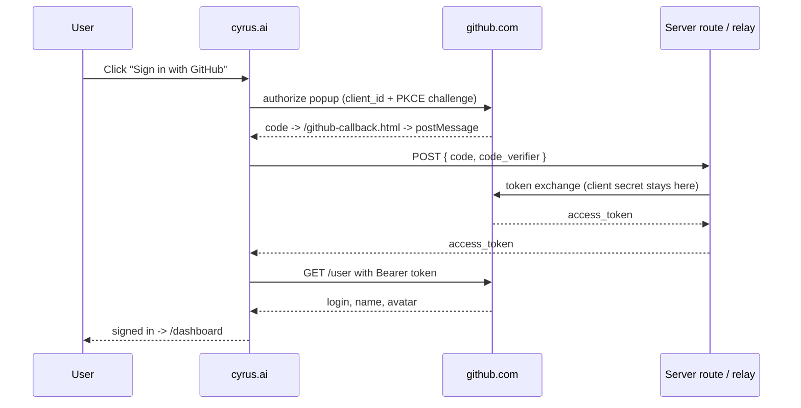
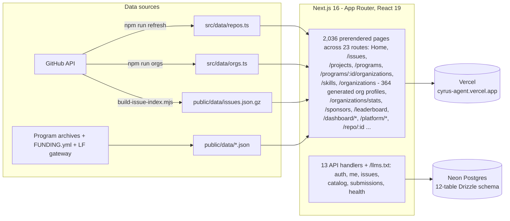

<p align="center">
  
</p>

<h1 align="center">cyrus.ai</h1>

<p align="center">
  <b>The open-source contribution platform.</b> 40,017 real open issues, an 8,754-project archive of mentored open-source programs, 364 organization profiles and a 1,528-repo agent-skills catalog - one warm, fast, self-refreshing site on Next.js 16, with <b>real sign-in</b> and a <b>server backend on Neon Postgres</b>.
</p>

<p align="center">
  <a href="https://cyrus-agent.vercel.app"></a>
  <a href="#by-the-numbers"></a>
  <a href="#by-the-numbers"></a>
  <a href="#by-the-numbers"></a>
  <a href="#by-the-numbers"></a>
  
</p>

<p align="center">
  <a href="https://www.producthunt.com/products/cyrus-ai?embed=true&amp;utm_source=badge-featured&amp;utm_medium=badge&amp;utm_campaign=badge-cyrus-ai" target="_blank" rel="noopener noreferrer"></a>
</p>

<p align="center">
  
  
  
  
  
  
  
  
</p>

<p align="center">
  <table>
    <tr>
      <td align="center"><b>Start</b><br/><a href="https://cyrus-agent.vercel.app">Open the site</a><br/><a href="#quick-start">Run locally</a><br/><a href="#deploy-on-vercel">Deploy</a></td>
      <td align="center"><b>Explore</b><br/><a href="https://cyrus-agent.vercel.app/issues">Issue finder</a><br/><a href="https://cyrus-agent.vercel.app/programs">Programs explorer</a><br/><a href="https://cyrus-agent.vercel.app/skills">Skills catalog</a></td>
      <td align="center"><b>Data &amp; auth</b><br/><a href="#how-the-data-is-built">Refresh pipeline</a><br/><a href="#sign-in-actually-real">OAuth design</a><br/><a href="#see-it-in-action">Screenshot tour</a></td>
    </tr>
  </table>
</p>

---

## The promise

> **Works like a product, ships like a static site - and never quotes a number it cannot point at.**

- **40,017 real open issues.** The Issue Finder crawls good-first-issue and help-wanted labels across the catalog with the GitHub Search API, then filters by language, label, organization, size and how recently each repository last merged a pull request. Beginner-labelled and nobody-assigned are filters read from the payload, not guesses.
- **A program archive, not a program poster.** 8,754 mentored projects across the 12 programs that publish a record we can read - GSoC's full 2016-2026 mirror, LFX, Outreachy, Summer of Bitcoin, GSSoC, 24 Pull Requests, Season of KDE, MLH, Nexus Spring of Code, Hacktoberfest, FOSSEE and Vercel OSS. Each row links to the organizer's own page for that project.
- **13 programs, each with its own organization explorer.** `/programs/:id/organizations` opens every organization that program's record names, as a card with its logo, its field, its technology stack and the seasons it took part in - filterable by year, stack and sector. Season of KDE groups its record by project area rather than host organization, and the page says so instead of presenting areas as orgs.
- **Named mentors, not advertised ones.** 6,170 mentor names read off the programs' own project rows: 4,917 on GSoC, 982 on the LFX record, 198 on the GSSoC board, 44 Summer of Bitcoin and 29 Season of KDE. Outreachy prints no mentor name anywhere in its archive, and its page says that too.
- **One catalog for the agent boom.** Skills, Cursor rules, AGENTS.md files, MCP servers and dev agents - all 1,528 of them, 33.79M stars between them, filterable and downloadable as JSON.
- **Organization intel that is actually live.** 364 organization profiles, every one named by a program's own record, each with live GitHub stats and the programs it appears in. Profiles for organizations no program claimed were removed rather than kept to pad the directory.
- **The same organization, counted once.** `/organizations/stats` folds every program-level archive into 967 organizations - 14,649 projects, 78 of them appearing in more than one program - by name, by GitHub login, and then by legal form, so "OWASP" and "OWASP Foundation" arrive as one row while two rows with two different confirmed accounts never fold. The eight programs that publish projects rather than hosts stay out of the count, and the page says which they are.
- **Follow the money.** The Sponsors directory reads `.github/FUNDING.yml` from the top 260 catalog repositories by stars and lists the 82 that actually take funding, with the right link to fund each one.
- **Proof over promises.** The PR Leaderboard ranks contributors from merged pull requests on real repositories, with open pull requests and reviews counted separately so a single number cannot be gamed.
- **A dashboard that works signed-out.** Saved issues and repositories, plus twelve screens built on the same datasets: a season calendar with a prefilled Google Calendar event per window and a whole year as `.ics`, a demand radar over five years of accepted projects, a repo analyser scoring any public repository live from GitHub, a four-file draft studio, a co-pilot matcher, a mentor finder, an organization comparison and a git-start script generator.
- **Real sign-in.** Google OIDC, GitHub OAuth with PKCE and a six-digit email code - designed end to end, with an honest answer from any button whose provider is not configured on that deploy.
- **A real backend, not a mock.** 13 API route handlers with signed-cookie sessions, cross-device saved items, applications, submissions and a catalog query API on Neon Postgres. [The backend](#the-backend) says exactly what is switched on and what is not.
- **Static where it should be.** Typed JSON snapshots are checked into the repo and regenerated by scripts, so catalog pages prerender and the first paint needs no server round trip.

## See it in action

Every shot below is the live site at 1440px.

<table>
  <tr>
    <td width="50%"></td>
    <td width="50%"></td>
  </tr>
  <tr>
    <td align="center"><b>Home</b> - the index itself as a hero, the program calendar, and drifting organization shelves</td>
    <td align="center"><b>Skills catalog</b> - 1,528 repositories with a filter rail, live stats and JSON export</td>
  </tr>
  <tr>
    <td></td>
    <td></td>
  </tr>
  <tr>
    <td align="center"><b>Issue finder</b> - 40,017 open issues, filtered by label, language, organization and difficulty</td>
    <td align="center"><b>Programs</b> - 13 mentored seasons with their windows and the participation record</td>
  </tr>
  <tr>
    <td></td>
    <td></td>
  </tr>
  <tr>
    <td align="center"><b>Organization intel</b> - 364 profiles, each named by a program record, with live stats</td>
    <td align="center"><b>Sponsors directory</b> - the 82 catalog repositories that take funding, from their FUNDING.yml</td>
  </tr>
  <tr>
    <td></td>
    <td></td>
  </tr>
  <tr>
    <td align="center"><b>Dashboard</b> - saved issues, tracked repositories and the setup checklist</td>
    <td align="center"><b>PR Leaderboard</b> - contributors ranked from merged pull requests on real repositories</td>
  </tr>
  <tr>
    <td></td>
    <td></td>
  </tr>
  <tr>
    <td align="center"><b>Co-pilot matcher</b> - language and interest shortlisted against live issues</td>
    <td align="center"><b>Project archive</b> - 8,754 mentored projects, filtered by year, organization and stack</td>
  </tr>
  <tr>
    <td></td>
    <td></td>
  </tr>
  <tr>
    <td align="center"><b>Platform / Features</b> - one of three marketing pages under <code>/platform/*</code></td>
    <td align="center"><b>About</b> - the method, the sources and the companies band</td>
  </tr>
</table>

Light and dark share one token set - the same coffee-and-honey palette, roasted or poured.

## By the numbers

| Section | Size | Source of truth |
|---|---:|---|
| Good-first-issue board | **40,017 open issues** · 290 repositories · 757 beginner-labelled | GitHub Search API via `scripts/build-issue-index.mjs`, crawled 2026-10-21 over 9,024 repositories |
| Program archive | **8,754 projects** · 8,731 rows browsable · 12 programs | `public/data/gsoc-projects.json` (5,238) + `otherProjects.json` (1,444) + every shard in `public/data/program-projects/index.json` |
| Program organization explorers | **616 organizations** · 13,539 projects · 380 resolved to a GitHub account | `scripts/contribo-orgs.mjs` folding each program's published organization record over our copy of its archive |
| Cross-program organization statistics | **967 organizations** · 14,649 archived projects · 78 appearing in more than one program · 486 with a confirmed GitHub account | `scripts/org-stats.mjs` → `public/data/org-stats.json`, folded three ways (name key, login key, then legal form, so "OWASP" and "OWASP Foundation" arrive as one row) and shown at `/organizations/stats` |
| Participation roster | **14,912 projects** · 11,265 distinct organizations · 126 in more than one program | `scripts/build-program-roster.mjs` over the 8 programs that publish a participant list |
| Named mentors | **6,170** across five programs | `scripts/build-mentor-index.mjs` - GSoC 4,917 · LFX 982 · GSSoC 198 · Summer of Bitcoin 44 · Season of KDE 29 |
| Linux Foundation member directory | **4,495 organizations** across its foundations | `lf-orgs.json`, from LF's own open gateway - a different population from the LFX Mentorship host list, and shown separately |
| Agent-skills catalog | **1,528 repositories** · 33.79M stars · 4.61M forks | GitHub REST via `gh api` |
| Organization profiles | **364** live GitHub profiles, every one named by a program | `scripts/fetch-orgs.mjs` → `src/data/orgs.ts`, which drops the fetched profiles no program's record mentions |
| Sponsors directory | **82 funded repositories**, found in the top 260 by stars | `.github/FUNDING.yml`, read repository by repository |
| Program pages | **13** deep dives, each with its own organization explorer and archive | `src/data/programDetails.ts` |
| Dashboard | 12 screens - overview, issues, repositories, calendar, demand radar, analyser, drafts, matcher, mentors, compare, git-start, settings | the datasets above, in the browser |
| Surface | **23** page routes + **14** route handlers (13 API + `/llms.txt`) | `src/app/` (App Router) |

Every figure in this table is the figure the site itself computes. `src/lib/siteStats.ts` derives the chrome's counts from the data modules, and `siteStats.test.ts` asserts the two archive totals against the JSON files on disk - a refresh that changes a file fails the test until the module and this table catch up.

### What the catalog is made of

| Category | Repos | Share |
|---|---:|---:|
| Dev tools & agents | 961 | 62.9% |
| Agent skills | 243 | 15.9% |
| MCP servers | 232 | 15.2% |
| AGENTS.md files | 50 | 3.3% |
| Cursor rules | 42 | 2.7% |

## The catalog at a glance

<p align="center">
  
</p>

<p align="center">
  
</p>

<p align="center">
  
</p>

## Inside the platform

- **The hero is the index.** The home page opens on real open issues from the crawl rather than on an illustration of them, so the first thing a visitor sees is the thing the product is for.
- **A graphite plate on the sign-in door.** The left panel is a dark measurement field: a dashed hairline grid, a brighter crosshair every fourth intersection, corner brackets, and the brand mark brushed in silver inside a raised tile dead centre of the plate. The grid is phase-shifted by a measured remainder so a crossing lands exactly behind the tile at any size - alignment, not decoration.
- **Living shelves.** Counter-drifting marquees for organizations and developer stories, hover to pause, click through to the real profile, with both ends faded inside the section column.
- **Light + dark, same soul.** A hand-tuned coffee-and-honey palette with a dainty sun/moon toggle; every colour is a CSS custom property, so both themes share one source of truth and no component carries a hex literal.
- **Filters where the question is.** Each program's organization explorer filters by year, stack and sector at the top of the list and stays there - it does not follow the page down over the cards.
- **Honest empty states.** A program that publishes no participant list, no mentor names or no project table says so on its page and shows nothing, rather than filling the gap with a lookalike.
- **Self-refreshing data.** `npm run refresh` re-pulls the GSoC archive; `npm run orgs` regenerates organization intel from live GitHub; `node scripts/build-issue-index.mjs` re-crawls the issue snapshot. Refresh stamps this README with the newest repository `updated` date in `src/data/repos.ts`, not the refresh date - so the snapshot badge cannot drift from the data.

## How the data is built

```
GitHub REST + Search API ──┬─▶ src/data/repos.ts ─────────────┐
                           ├─▶ src/data/orgs.ts ──────────────┤
                           ├─▶ public/data/issues.json.gz ────┼─▶ typed snapshots, checked in
Programs' own archives ────┤    gsoc-projects.json            │      ↓
                           │    otherProjects.json            ├─▶ 2,036 prerendered pages
LF open gateway ───────────    program-projects/*.json       │      ↓
Contribo organization feed ┘    program-roster.json ──────────   Vercel edge
                                mentor-index.json · sponsors.json · org-stats.json
```

Each source keeps its own file and its own provenance note inside it, so a reader of the JSON can tell an organizer's published archive from a topic listing, and a wishlist from a mentored project. Where two sources describe the same organization, the merge is by GitHub login first and normalized name second, and the count of unresolved names stays visible in the file rather than being quietly dropped.

## Pages

| Route | What it is |
|---|---|
| `/` | Home: the live issue board as a hero, what the product does, programs, the contributor year, organization shelves, FAQ |
| `/issues` | Good-first-issue finder over 40,017 real open issues - labels, languages, organizations, difficulty |
| `/organizations` · `/organizations/:login` | 364 GitHub organizations that a program's own record names, with live stats and program badges, plus the rest of the participation roster |
| `/organizations/stats` | Every organization named by a program-level archive, counted once across programs: 967 rows, 14,649 projects, sector and technology breakdowns, per-season counts and the logos GitHub publishes |
| `/projects` | The 8,754-project mentored-program archive, filterable by year, organization, stack and program |
| `/programs` · `/programs/:id` | 13 funded programs - windows, who they are for, their project record, their named mentors and their participation row |
| `/programs/:id/organizations` | That program's organization explorer: every organization its record names, filterable by year, stack and sector |
| `/skills` | The 1,528-repository agent-skills catalog, filterable and downloadable - the active filter and sort live in the URL, so the view you are looking at is the link you can send |
| `/llms.txt` | A plain-text index of the site for AI agents, generated from the same snapshots |
| `/sponsors` | The 82 catalog repositories that actually take funding, read from their FUNDING.yml |
| `/leaderboard` | Contributor rankings from merged pull requests |
| `/dashboard` | Signed-in home - saved issues, tracked repositories and the setup checklist; the tracked list exports as CSV or JSON |
| `/dashboard/calendar` · `/demand` · `/analyser` · `/drafts` | Season calendar with Google Calendar and `.ics` export, demand radar over five years of accepted projects, live repository analyser, four-file draft studio |
| `/dashboard/matcher` · `/mentors` · `/compare` · `/gitstart` | Co-pilot matcher, mentor finder, organization comparison, git-start script generator |
| `/platform/features` · `/platform/how` · `/platform/trust` | Marketing pages and the trust centre |
| `/about` | The story, the method and the companies behind the index |
| `/repo/:id` | Repository detail with stats, tags and related projects |
| `/privacy` · `/terms` · `/cookies` · `/affiliations` | The honest legal corner |

## Quick start

```bash
git clone https://github.com/adityalenova/cyrus-ai && cd cyrus-ai
npm install
cp .env.example .env        # optional - everything runs with an empty .env too
npm run dev                 # http://localhost:5330
```

```bash
npm run build               # next build
npm test                    # vitest: 33 files, unit + data-integrity suites
npm run check               # tsc --noEmit + next build
npm run refresh             # re-pull the GSoC archive + stamp this README's snapshot date
npm run orgs                # regenerate src/data/orgs.ts from live GitHub
node scripts/build-issue-index.mjs    # re-crawl the 40k-issue snapshot
npm run gh-relay            # local GitHub token-exchange relay on :8787
npm run db:push && npm run db:seed    # only with a DATABASE_URL (Neon)
```

Environment, all optional - the site degrades gracefully without any of them:

```
# public, shipped to the browser
NEXT_PUBLIC_GOOGLE_CLIENT_ID=...      # Google OAuth web client id
NEXT_PUBLIC_GITHUB_CLIENT_ID=...      # GitHub OAuth app client id
NEXT_PUBLIC_GITHUB_EXCHANGE_URL=...   # relay only if you skip the server routes
NEXT_PUBLIC_TURNSTILE_SITE_KEY=...    # Cloudflare widget key, with the secret below

# server-side, never bundled
DATABASE_URL=...                      # Neon Postgres (pooled)
SESSION_SECRET=...                    # signs the session cookie
GITHUB_CLIENT_SECRET=...              # enables /api/auth/github exchange
RESEND_API_KEY=...                    # email sign-in codes (demo mode without)
EMAIL_FROM=...                        # sender on a domain verified in Resend (required in production)
TURNSTILE_SECRET_KEY=...              # siteverify secret, with the site key above
```

## Sign-in, actually real

<details open>
<summary><b>Google and email codes complete on the live site; GitHub and the Cloudflare box each need two keys</b></summary>

- **Google** - raw OIDC implicit flow (full-page redirect, no GIS script dependency). The `id_token` returns in the URL fragment; the nonce is verified against `sessionStorage`, the token is re-verified server-side at `/api/auth/google` before a session cookie is issued, and the page you left is the page you come back to. **This path completes end to end on the live site.** It used to land back on "Sign in to open the board": the sheet wrote the user, then the store's own localStorage read, running one frame later, wrote back the `null` a previous sign-out had left there. `useStored` now lets the first read fill in a value nobody has touched, and the redirect finishes in `StoreProvider`, above every gate.
- **GitHub** - OAuth **PKCE (S256)** in a popup. The code lands on same-origin `github-callback.html` and is post-Messaged back; `/api/auth/github` trades it for a token server-side (the client secret never touches the browser), or a relay does the same job for a pure-static deploy - `npm run gh-relay` in dev, the Cloudflare Worker in prod. Finishing a GitHub sign-in needs `NEXT_PUBLIC_GITHUB_CLIENT_ID` **and** `GITHUB_CLIENT_SECRET` on top of `SESSION_SECRET`, and `/api/health` reports which it has as `github: true|false`. With either missing the button answers honestly - "GitHub sign-in is not connected on this deploy, use the email code below" - instead of opening a popup that can never land.
- **Email** - a six-digit code via Resend at `/api/auth/email/*`; with no `RESEND_API_KEY` the code comes back in the response, which is how the flow is driven locally. `EMAIL_FROM` must be an address on a domain verified in Resend; Resend's shared `onboarding@resend.dev` sender only delivers to the account owner, so it is a fallback outside production. `/api/health` reports `email` as `missing_key`, `unverified_from` or `ok`.
- **Cloudflare Turnstile** - once `NEXT_PUBLIC_TURNSTILE_SITE_KEY` and `TURNSTILE_SECRET_KEY` are both set, the sign-in sheet renders a managed widget and `POST /api/auth/email/start` refuses to send a code without a token that `siteverify` accepts. It is deliberately all-or-nothing: with either key missing the widget never mounts and no Cloudflare script loads, and with both present the check fails closed, so a Cloudflare outage stops code sending instead of quietly skipping the gate. The 30-second resend lock and the six-try code lock in `email.ts` stay, and `/api/health` reports the state as `captcha: true|false`. **There is no widget on the live deploy yet** (`captcha: false`) because neither key exists; creating one is the whole step, and since the site key is baked into the client bundle at build time it needs a redeploy.



**Security stance:** the repository and the browser bundle contain **only public client ids**. The GitHub client secret lives in a Next.js server env var (or a Worker secret for the static fallback) - never in git, never in the page.

</details>

## The backend

cyrus.ai is not a static page with a fake sign-in. The server side is a real Next.js App Router API: **13 route handlers and a 12-table Postgres schema** managed by Drizzle, on Neon's serverless driver.

<details>
<summary><b>Every endpoint, what it does and who may call it</b></summary>

| Endpoint | Methods | Purpose | Auth |
|---|---|---|---|
| `/api/auth/google` | POST | Verifies a Google ID token and starts a session - a `users` row when a database exists, a cookie from the claims when it does not | public |
| `/api/auth/github` | POST | Exchanges a GitHub code for a token, reads `/user`, starts a session the same way | public |
| `/api/auth/email/start` | POST | Issues a 6-digit code and mails it (Resend); stores only the sha256 hash | public, rate-capped by the 1-code-per-email unique index |
| `/api/auth/email/verify` | POST | Checks the code (6 tries before it burns) and signs the session in | public |
| `/api/auth/logout` | POST | Clears the session cookie | session |
| `/api/me` | GET | Current user profile for the dashboard and header avatar | session |
| `/api/me/saved` | GET · POST · DELETE | Cross-device saved repositories, organizations and programs | session, own rows only |
| `/api/me/applications` | GET · POST · PATCH · DELETE | Program applications in progress: status, drafts, notes | session, own rows only |
| `/api/issues` | GET | Rate-capped search over the 40k-issue snapshot, facets included | public |
| `/api/catalog/repos` | GET | Catalog rows with filters and paging, straight from the database | public |
| `/api/catalog/counts` | GET | Live totals the chrome and this README quote | public |
| `/api/submissions` | POST | "Submit a project" intake | public |
| `/api/health` | GET | `{ ok, db, auth, google, github, captcha, time }` - the deployment probe, booleans only and never a key | public |

</details>

<details>
<summary><b>The schema</b></summary>

Two halves, in `src/lib/db/schema.ts`:

| Table | Stores |
|---|---|
| `users` | one row per identity, unique on `(provider, provider_id)`; profile fields carried from GitHub, Google or email |
| `email_codes` | the live verification code per address - hash, expiry and attempt counter, never the code itself |
| `saved_items` | what a person starred, unique per `(user, type, item)`, cascaded on user delete |
| `applications` | program applications with status and free-form notes |
| `submissions` | projects people ask to have listed |
| `repos` · `orgs` · `org_repos` · `hackathons` · `program_projects` · `resources` | the catalog mirrored server-side so counts and filters can come from the database instead of a bundle; `hackathons` and `resources` are legacy tables kept for old rows - no page serves them |
| `catalog_meta` | snapshot stamp and totals for `/api/catalog/counts` |

Migrations live in `drizzle/`; `npm run db:generate`, `db:push`, `db:migrate`, `db:seed` and `db:studio` are all wired in `package.json`.

</details>

**Sessions** are stateless signed JWTs (`jose`, HS256) in an `httpOnly`, `sameSite=lax`, path-scoped cookie named `cyrus.session`, valid 30 days, `secure` in production. No session table, which keeps the Neon HTTP driver request-scoped. The browser also keeps a localStorage mirror, so the dashboard still works signed-out and the two reconcile on sign-in.

**A database is not part of signing in.** `SESSION_SECRET` alone is enough: `issueSession` writes a `users` row when `DATABASE_URL` exists and otherwise mints the cookie straight from the provider's verified claims, with the id `google:<sub>`, `github:<id>` or `email:<address>` so the same account resolves to the same id on every deploy, and `/api/me` reads either one back. What `DATABASE_URL` actually buys is the part a browser cannot hold: cross-device saved items and the application tracker, which stay `401` until it is set.

**Current deployment state, stated honestly:** `GET https://cyrus-agent.vercel.app/api/health` answers `{"ok":true,"db":false,"auth":true,"google":true,"github":false,"captcha":false}`. On the live site that means Google and email-code sign-in both complete and open the board; saved items and the application tracker stay on-device until a database is attached; GitHub gives its honest "not connected" answer; and no Cloudflare box appears, because no widget key is configured. The four switches left are all outside this repository - attach a Neon Postgres and set `DATABASE_URL`, verify a sending domain in Resend so codes reach anyone other than the account owner, add `GITHUB_CLIENT_SECRET` beside the GitHub client id, and create a Turnstile widget for the key pair. See [Deploy on Vercel](#deploy-on-vercel).

**Hosting, CDN and TLS:** the site runs on `cyrus-agent.vercel.app`, served from Vercel's edge network (responses carry `x-vercel-cache: HIT` and a regional id such as `bom1::`) over TLS 1.3 with a valid certificate and `Strict-Transport-Security: max-age=63072000; includeSubDomains; preload`. No custom domain is attached to the team, so there is nothing to delegate to Cloudflare DNS yet - Cloudflare is used today only for Turnstile, and once a domain exists it can front the same deployment for DNS, CDN and an edge certificate.

## Architecture

<details>
<summary><b>How a 10k-dataset site boots instantly on Next.js</b></summary>



Catalog pages render from typed, checked-in snapshots, so the first paint needs no server. Charts, filters and the dashboard tools are computed in-app from those same snapshots. The API layer is additive on top of that: it owns sessions, saved items, applications and submissions, and answers 503 with a clear `backend offline` body rather than half-working when its env vars are absent.

```
src/
├── app/          App Router: 23 pages + 14 route handlers (13 API + llms.txt)
├── views/        21 page components (Home, IssueFinder, Programs, ProgramOrgs, ...)
├── components/   chrome, cards, the auth modal and its sign-in plate, hero, UI primitives
├── lib/          store, router shim, google.ts (OIDC), github.ts (PKCE),
│                 contriboOrgs.ts, programRoster.ts, programProjects.ts,
│                 dash/ (dashboard shell + tools), api.ts (client),
│                 server/ (auth, db, queries, email, issueIndex, turnstile)
└── data/         typed dataset snapshots (repos, orgs, programs, roster, leaderboard)
public/data/      issues.json.gz · gsoc-projects.json · otherProjects.json ·
                  program-projects/ · program-roster.json · mentor-index.json ·
                  contribo-orgs.json · sponsors.json · lf-orgs.json
scripts/
├── refresh.mjs                 GSoC archive re-pull + README snapshot stamp
├── build-issue-index.mjs       GitHub Search API -> the 40k-issue snapshot
├── build-crawl-data.mjs        catalog crawl -> repos.ts + crawlStats.ts
├── fetch-orgs.mjs              live GitHub organization intel -> orgs.ts
├── build-program-projects.mjs  each program's record -> its shard + index
├── build-program-roster.mjs    participant lists -> the participation roster
├── build-mentor-index.mjs      mentor names read off archived project rows
├── contribo-orgs.mjs           each program's organization record, merged
├── github-exchange.local.mjs   dev token-exchange relay (:8787)
└── github-exchange.worker.mjs  Cloudflare Worker relay (static-hosting prod)
drizzle/                        SQL migrations for the Neon schema
```

</details>

## Deploy on Vercel

A `vercel.json` pins the Next.js preset, so importing the repository is all it takes:

1. [vercel.com/new](https://vercel.com/new) - import `cyrus-ai` - Deploy.
2. Retype the env vars from `.env.example` in Project Settings (Production + Preview). Never upload your `.env` file. Public client ids and the Turnstile site key are safe; `SESSION_SECRET`, `GITHUB_CLIENT_SECRET`, `DATABASE_URL`, `RESEND_API_KEY` and `TURNSTILE_SECRET_KEY` belong only here.
3. Register the production origin with Google (JS origin **and** redirect URI with trailing slash) and GitHub (callback `<origin>/github-callback.html`).
4. To switch the backend on: attach a Neon Postgres, set `DATABASE_URL` and `SESSION_SECRET`, run `npm run db:migrate` and `npm run db:seed`. `/api/health` flips to `{"db":true,"auth":true}`, sessions persist across devices, and submissions land in the database. Until then the routes answer 503 and the site runs on checked-in snapshots plus localStorage.
5. Pure-static alternative for GitHub sign-in: deploy `scripts/github-exchange.worker.mjs` as a Cloudflare Worker and point `NEXT_PUBLIC_GITHUB_EXCHANGE_URL` at it.

## Tech stack

| Layer | Choice | Notes |
|---|---|---|
| Framework | Next.js 16 App Router + React 19 | catalog pages prerender; a router shim keeps the ported views untouched |
| Language | TypeScript 5 strict | `noUnusedLocals`, `noUnusedParameters`; the build fails on any error |
| Styling | Tailwind v4 | CSS-first config, warm coffee-and-honey palette, light/dark from one token set |
| Data | Node ESM scripts | `gh api` plus each program's public endpoint; snapshots in git |
| Auth | Google OIDC · GitHub PKCE · email codes | server routes first, Cloudflare/local relay as static fallback |
| Database | Neon Postgres + Drizzle ORM | 12 tables: accounts, saved items, applications, submissions and a server-side mirror of the catalog |
| Sessions | `jose` HS256 JWT | `httpOnly` `sameSite=lax` cookie, 30-day expiry, no session table |
| Visualization | hand-rolled canvas + SVG | catalog charts, program bars, sparklines - no chart library |
| Motion | Framer Motion | section reveals and the hero, both behind `prefers-reduced-motion` |
| Email | Resend | one-tap sign-in codes; only the hash of a code is stored |
| Tests | Vitest | 33 files, 295 tests - unit, API-route and data-integrity suites |
| Hosting | Vercel | `vercel.json` pins the Next.js preset |

## Contribute & support

This is a solo build that grew into a platform - and it gets better every time someone points out a missing repository, a stale deadline or a broken filter. **Contributions of every size are welcome**, and everyone whose pull request gets merged lands on this wall.

**Good first contributions:**

- **Catalog gaps** - know an agent-skills, MCP or Cursor-rules repository we should index? Open an issue with the `github.com/owner/name` and it gets pulled in on the next refresh.
- **Issue-board spot-checks** - if a repository on the issue finder looks stale, closed or wrongly labelled, a one-line fix to the crawler filters in `scripts/` is a perfect first pull request.
- **Design notes** - screenshots of anything that looks off in light or dark mode, at any viewport, are genuinely useful.
- **Data plumbing** - the scripts in `scripts/` are plain Node ESM; new sources or smarter merges are always interesting.

**How to get started:** fork the repository, run [Quick start](#quick-start) above, open a pull request. CI is the strict build itself (`npm run build` must pass).

### The people behind it

**22 pull requests** from **12 contributors** have landed alongside the creator's own 12 - a URL-state sync here, a lost `LICENSE` there, an API test suite nobody had written. Each merged pull request earns a slot on this wall.

<table>
  <tr>
    <td align="center" width="112">
      <a href="https://github.com/adityalenova"></a><br/>
      <sub><b><a href="https://github.com/adityalenova">adityalenova</a></b></sub><br/>
      <sub>creator · everything</sub>
    </td>
    <td align="center" width="112">
      <a href="https://github.com/Harshit214713"></a><br/>
      <sub><b><a href="https://github.com/Harshit214713">Harshit214713</a></b></sub><br/>
      <sub>9 PRs · export, SSG, URL state</sub>
    </td>
    <td align="center" width="112">
      <a href="https://github.com/bhavesh-patil2007"></a><br/>
      <sub><b><a href="https://github.com/bhavesh-patil2007">bhavesh-patil2007</a></b></sub><br/>
      <sub>header dropdowns · contributor docs</sub>
    </td>
    <td align="center" width="112">
      <a href="https://github.com/dailyun"></a><br/>
      <sub><b><a href="https://github.com/dailyun">dailyun</a></b></sub><br/>
      <sub>snapshot date · dead dependency</sub>
    </td>
    <td align="center" width="112">
      <a href="https://github.com/chanchall26"></a><br/>
      <sub><b><a href="https://github.com/chanchall26">chanchall26</a></b></sub><br/>
      <sub>API route test suite</sub>
    </td>
    <td align="center" width="112">
      <a href="https://github.com/Anshuu2004"></a><br/>
      <sub><b><a href="https://github.com/Anshuu2004">Anshuu2004</a></b></sub><br/>
      <sub>honest mail failures</sub>
    </td>
    <td align="center" width="112">
      <a href="https://github.com/Akhil-Pisipati"></a><br/>
      <sub><b><a href="https://github.com/Akhil-Pisipati">Akhil-Pisipati</a></b></sub><br/>
      <sub>sign-in back button</sub>
    </td>
  </tr>
  <tr>
    <td align="center" width="112">
      <a href="https://github.com/sumittiwari1302"></a><br/>
      <sub><b><a href="https://github.com/sumittiwari1302">sumittiwari1302</a></b></sub><br/>
      <sub>prerendered repo pages</sub>
    </td>
    <td align="center" width="112">
      <a href="https://github.com/shahkhushi0307"></a><br/>
      <sub><b><a href="https://github.com/shahkhushi0307">shahkhushi0307</a></b></sub><br/>
      <sub>filters in the URL</sub>
    </td>
    <td align="center" width="112">
      <a href="https://github.com/nirajbhayera4"></a><br/>
      <sub><b><a href="https://github.com/nirajbhayera4">nirajbhayera4</a></b></sub><br/>
      <sub>skip-to-content link</sub>
    </td>
    <td align="center" width="112">
      <a href="https://github.com/ArshiBansal"></a><br/>
      <sub><b><a href="https://github.com/ArshiBansal">ArshiBansal</a></b></sub><br/>
      <sub>the LICENSE</sub>
    </td>
    <td align="center" width="112">
      <a href="https://github.com/PolarDyth"></a><br/>
      <sub><b><a href="https://github.com/PolarDyth">PolarDyth</a></b></sub><br/>
      <sub>PWA manifest + icons</sub>
    </td>
    <td align="center" width="112">
      <a href="https://github.com/Siddesh-G-H"></a><br/>
      <sub><b><a href="https://github.com/Siddesh-G-H">Siddesh-G-H</a></b></sub><br/>
      <sub>the Save button's cursor</sub>
    </td>
    <td align="center" width="112">
      <a href="https://github.com/adityalenova/cyrus-ai/pulls"></a><br/>
      <sub><b><a href="https://github.com/adityalenova/cyrus-ai/pulls">your PR here</a></b></sub><br/>
      <sub>first fix earns a slot</sub>
    </td>
  </tr>
</table>

<p align="center">
  <a href="https://github.com/adityalenova/cyrus-ai/pulls"></a>
  <a href="https://github.com/adityalenova/cyrus-ai/issues"></a>
  <a href="https://x.com/iaditya_offical"></a>
</p>

## Support cyrus.ai

Not a code person? The cheapest support with the biggest impact:

1. **Star the repository** - it helps the catalog get discovered by the people who need it.
2. **Share a screenshot** of your dashboard or your favourite organization page.
3. **Send one link** to a builder who is hunting their first good issue or picking a program.

## Thanks to the data neighbors

Every number on this site belongs to the teams who produced it: Google Summer of Code and its mentoring organizations, the Linux Foundation, Outreachy, MLH, GSSoC, KDE, Summer of Bitcoin, 24 Pull Requests, FOSSEE, Vercel, nsoc.in, Contribo, and the 1,528 open-source repositories indexed from GitHub. Each listing links out to its official page.

## License & credits

Private project, built by [Aditya Duggirala](https://github.com/adityalenova) · [@iaditya_offical on X](https://x.com/iaditya_offical). All catalog data belongs to its respective sources and is republished with attribution and links. Made with too much coffee, in the site's own palette.
